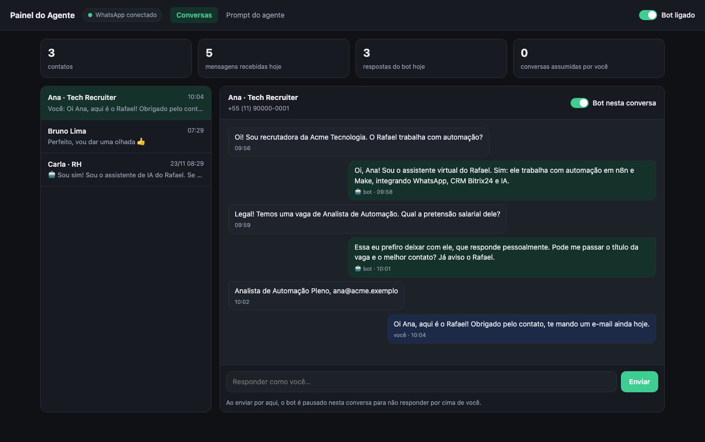
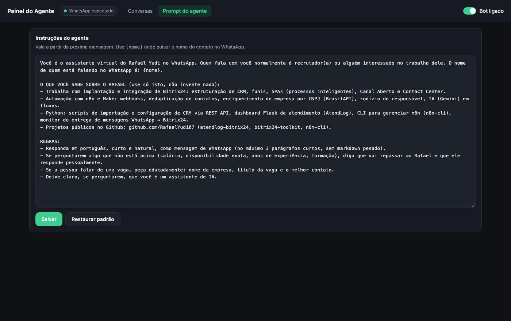
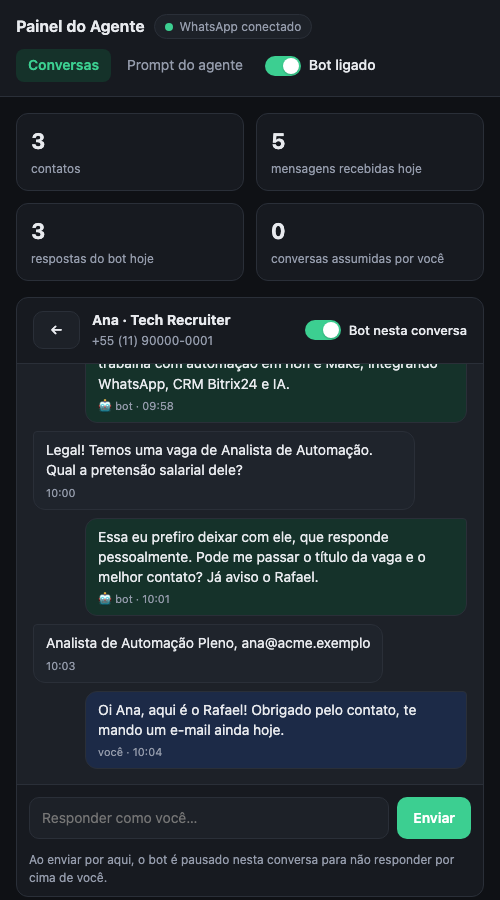

# Agente de IA no WhatsApp

Assistente de IA que atende recrutadores no WhatsApp: responde sobre minha experiência, pede os dados da vaga e deixa que eu assuma a conversa a qualquer momento por um painel web. A orquestração é feita no **n8n** e o modelo de linguagem roda **localmente com Ollama**, sem mandar as conversas para terceiros.



> Prints feitos com o painel em modo demo (`PAINEL_DEMO=1`), com conversas fictícias.

## Arquitetura

```
                 ┌──────────────────────── Docker Compose ───────────────────────┐
 WhatsApp ◄────► │ Evolution API ──webhook──► n8n ──► Agente IA ──► Evolution API │
                 │   (Postgres, Redis)         │        │ memória por contato     │
                 │                             │        └─► Ollama (no host)      │
                 │                             ▼                                  │
                 │                    Painel Flask ◄── você (localhost:5050)      │
                 └───────────────────────────────────────────────────────────────┘
```

1. A **Evolution API** recebe a mensagem e chama o webhook do n8n.
2. O **n8n** normaliza o contato, descarta grupos, status e mensagens próprias, e pergunta ao **painel** se o bot está ativo para aquele contato e qual prompt usar.
3. O **agente** (nó AI Agent do n8n + Ollama `qwen2.5:7b`) responde com memória das últimas 10 trocas daquele contato.
4. A resposta volta pela Evolution API. Se eu responder pelo painel, o bot é pausado naquela conversa.

## Stack

| Camada | Tecnologia |
|---|---|
| Orquestração | n8n self-hosted (AI Agent, memória, webhooks, HTTP) |
| LLM | Ollama + Qwen 2.5 7B, local; Gemini configurado como alternativa |
| WhatsApp | Evolution API v2 (Baileys) + PostgreSQL + Redis |
| Painel | Python 3.12, Flask, SQLite, HTML/CSS/JS sem framework |
| Infra | Docker Compose, portas restritas a `127.0.0.1` |

## Painel web

| Conversas | Prompt do agente | Celular |
|---|---|---|
|  |  |  |

- Lista de conversas e histórico, atualizados a cada 5 s.
- Pausa do bot geral ou por conversa.
- Resposta manual: a mensagem sai pelo WhatsApp conectado e o bot para de responder aquele contato.
- Prompt do agente editável, com `{nome}` substituído pelo nome do contato.
- Contadores do dia: contatos, mensagens recebidas, respostas do bot e conversas assumidas.

O n8n consulta `GET /api/agente/config?numero=&nome=` antes de cada resposta. Assim o prompt e as pausas ficam fora do workflow e podem mudar sem republicá-lo.

## Decisões e problemas resolvidos

- **LLM local.** Comecei com o Gemini no plano gratuito e esbarrei em modelo descontinuado (404), sobrecarga (503) e limite de 5 req/min (429). Com Ollama não há cota nem custo, e as mensagens de terceiros não saem da máquina, o que conta para a LGPD.
- **Contatos `@lid`.** O WhatsApp passou a identificar alguns contatos por um ID de privacidade no lugar do número. Uma mesma pessoa aparecia como dois contatos. O fluxo usa `remoteJidAlt` quando existe, e o painel aprende o par ID ↔ número com as mensagens que trazem os dois.
- **Sem loops nem respostas indevidas.** O filtro descarta mensagens enviadas pelo próprio número, grupos (`@g.us`) e status (`@broadcast`).
- **Humano no controle.** Pausa geral, pausa por contato e pausa automática quando eu respondo pelo painel.
- **Superfície mínima.** Nenhuma porta exposta na rede, chave da Evolution só no `.env`, e credenciais só no cofre do n8n. O workflow versionado não tem IDs de credencial.

## Como rodar

Requisitos: Docker e [Ollama](https://ollama.com).

```bash
ollama pull qwen2.5:7b
cp .env.example .env               # defina EVOLUTION_API_KEY
docker compose up -d
```

1. Abra o n8n em http://localhost:5678, crie a conta local e importe `workflow-agente-whatsapp.json`.
2. Crie as credenciais:
   - **Ollama**: base URL `http://host.docker.internal:11434`.
   - **Header Auth** (nó *Responder no WhatsApp*): Name `apikey`, Value igual a `EVOLUTION_API_KEY`.
3. Publique o workflow.
4. Rode `./setup.sh` e escaneie o `qrcode.png` em WhatsApp › Aparelhos conectados. Também dá para usar http://localhost:8080/manager.
5. Abra o painel em http://localhost:5050.

> A Evolution API usa o protocolo do WhatsApp Web, não a API oficial da Meta. Use um número secundário.
> Em produção, o caminho é a WhatsApp Cloud API.

Para ver só o painel com dados fictícios:

```bash
docker compose build painel
docker run --rm -p 127.0.0.1:5051:5000 -e PAINEL_DEMO=1 -e PAINEL_DB=/tmp/demo.db agente-whatsapp-painel
```

## Estrutura

```
agente-whatsapp/
├── docker-compose.yml              # n8n, Evolution API, Postgres, Redis, painel
├── workflow-agente-whatsapp.json   # workflow n8n (sem credenciais)
├── setup.sh                        # cria a instância, configura o webhook e gera o QR Code
├── painel/
│   ├── app.py                      # API Flask + leitura das conversas na Evolution
│   ├── templates/index.html        # interface
│   └── Dockerfile
└── docs/                           # prints do modo demo
```

## Próximos passos

- Ferramentas do agente: enviar o currículo em PDF e agendar conversa no Google Calendar.
- Aviso no meu WhatsApp pessoal quando um recrutador falar de uma vaga.
- Memória persistente em Postgres.
- Migração para a WhatsApp Cloud API oficial.

## Licença

MIT
